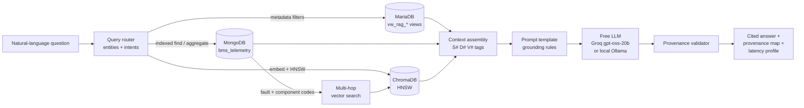

# Project Gigavolt — Milestone 5: Multi-Model Integration & Hybrid RAG Retrieval Engine

> ISTM 622 · Advanced Data Management · Fall 2026 · Amey Dhote

Milestone 5 turns the lakehouse into an **Enterprise Knowledge Engine**: a field engineer types a
question in plain English and gets an answer that is assembled from three different databases, generated
by an LLM, and **cited down to the exact record**, in under five seconds.

| Source | Engine | What it contributes | Citation tag |
|---|---|---|---|
| Structured ERP | MariaDB, single instance (Milestone 1–2 data), `gigavolt_silver` via `vw_rag_*` views | equipment metadata, warranty status, service history, warranty claims, parts → suppliers | `[S#]` |
| IoT telemetry | **MongoDB** `gigavolt_iot.bms_telemetry` (new in M5) | BMS fault codes, sensor readings, flagged components, event sequences | `[D#]` |
| Technical documents | ChromaDB HNSW (built in `data/chroma_db`, same design as Milestone 4) + all-MiniLM-L6-v2 | manuals, SOPs, ECOs, incident reports, datasheets, supplier reports | `[V#]` |
| Supply-chain graph | ~~Neo4j~~ | **Removed from M5 by the instructor's Nov 2 correction** (rubric item → full credit). Supplier context comes from ERP parts data and the supplier-report PDFs instead. | `[G#]` reserved |

## Architecture and data flow



1. **Route** (`gigavolt_rag/router.py`, < 1 ms). Regexes extract serial numbers, equipment IDs, models,
   fault codes and component codes; keyword rules classify intent (unit history, warranty, failure analysis,
   supply chain, telemetry, procedure). The plan says which databases to query, with which filters, and
   prints a one-line reason for every source used or skipped. A procedure question goes to ChromaDB only. A
   unit question gets an exact ERP lookup and a telemetry timeline.
2. **Retrieve in parallel** (`gigavolt_rag/retrieval.py`). MariaDB, MongoDB and ChromaDB run in three
   threads. If one source fails, the error is recorded and the answer is built from the others.
3. **Multi-hop.** Fault codes and component codes found in telemetry (e.g. `ERR_INV_404`, `INV-SCR-9901`)
   drive a second vector search. That pulls in the engineering change order or incident report about those
   exact codes.
4. **Assemble context.** Each record gets a citation tag plus its metadata (database, record ID, document
   and page, timestamp). Evidence of absence ("no ERP row for SN-4829") is a citable record too, so the
   model can say "not found" instead of guessing.
5. **Generate** (`prompts/system_prompt.txt`, `gigavolt_rag/llm.py`). Free models only: by
   default `openai/gpt-oss-20b` on **Groq's free tier** (reasoning effort low, about 1 s per answer), or
   **Llama 3.2 3B on a local Ollama server** on the same instance (no key, no account). Anthropic, OpenAI or
   an **extractive no-LLM mode** can be swapped in with one `.env` setting. On the free tier, batch scripts
   space calls ~30 s apart to stay under its tokens-per-minute limit; the pauses are excluded from latency.
6. **Validate provenance** (`gigavolt_rag/provenance.py`). Every sentence must carry a tag that exists in
   the context. The validator reports citation coverage, invented tags, and **numbers that do not appear in
   the cited record**. `scripts/verify_citation.py` re-runs the stored query against the live database to
   prove a citation.

## Why each database (polyglot persistence)

- **MariaDB for ERP facts.** These are relational, constrained and transactional. Exact filters (serial,
  model, warranty status) and aggregates are what SQL does best. The RAG account can `SELECT` four views
  only, continuing Milestone 2's least-privilege model. Customer identities and part costs never reach the
  LLM.
- **MongoDB for telemetry.** BMS events are semi-structured: a nested `telemetry` sub-document, a
  variable-length `flagged_components` array, and optional fault codes. A document store keeps each event
  intact. Its compound indexes (`equipment_id+timestamp`, `fault_code+timestamp`,
  `model_code+is_fault+timestamp`), the multikey index on the components array, the nested-field index on
  `telemetry.temperature_c`, and a text index on notes serve every diagnostic query with an IXSCAN. A
  `$jsonSchema` validator plus a Python normalizer quarantine bad records instead of dropping them silently.
- **ChromaDB for documents.** Meaning-based search over PDFs that SQL cannot do. `scripts/00_build_vector_store.py`
  downloads the 25 PDFs and rebuilds the Milestone 4 design inside Milestone 5, so this folder stands alone:
  page-level extraction, 900/180-character chunks, all-MiniLM-L6-v2, HNSW (cosine, M=16, ef_construction=200,
  ef_search=64), 101 vectors.
- **Why not a graph DB.** Removed by the instructor. The supply-chain question is still answered: ERP parts
  give supplier and manufacturer, telemetry gives which components are failing, and supplier reports give the
  tier-1/2/3 chain and single-source risks.

## How hallucination is prevented

| Layer | Mechanism |
|---|---|
| Retrieval | Exact-match lookups only (SN-4829 is never "fuzzy-matched" to DISP-14829). Empty lookups become explicit absence records. Low-similarity chunks (cosine distance > 0.80) are dropped. An out-of-scope question returns "no context" with no LLM call. |
| Prompt | The model may use only the tagged context. Every sentence needs a tag. Numbers must be copied exactly, sources must not be conflated, and safety advice must come from a cited SOP. |
| Generation | Low effort, no extended thinking, short answer budget, fixed output format (Answer / Key findings / Gaps). |
| Post-check | Citation coverage %, invalid-tag detection, and a numeric-grounding check, all shown with every answer. |
| Audit | `verify_citation.py` re-executes the SQL, Mongo pipeline or Chroma `get` behind any tag. |
| Failure handling | LLM timeout or bad key → retry, then an extractive answer that is 100% cited. A database outage → partial answer with a warning. |

## Folder layout

```text
Milestone_5/
├── config/            mongod.conf, docker-compose.mongodb.yml
├── setup/             run_all.sh + 00 .env · 01 MariaDB + ERP · 02 MongoDB · 03 venv · 04 load data · 05 RAG user · 06 verify
├── sql/               01_rag_views_and_indexes.sql
├── gigavolt_rag/      router, retrieval, sources/(sql|vector|document), prompts, llm, provenance, pipeline, display
├── prompts/           system_prompt.txt, answer_template.txt   (sample prompt templates)
├── scripts/           00 build vector store · 01 load telemetry · 02 telemetry queries · 03 health check · ask.py
│                      04 test queries · 05 latency benchmark · verify_citation.py
├── tests/             test_offline.py (22 offline tests), test_queries.json, fixtures/
└── output/            test_results/ (answers + provenance maps), benchmark/ (P50/P95/P99 report + chart)
```

## Quick start (one EC2 instance)

Fresh Ubuntu EC2 instance, normal `ubuntu` user (the script calls `sudo` itself where needed):

```bash
git clone https://github.com/ameyZd/project-gigavolt-data-lakehouse.git
cd project-gigavolt-data-lakehouse/Milestone_5
bash setup/run_all.sh          # asks once: free Groq key, or Enter = local Ollama; then runs steps 0-6
```

| Step | Script | What it does |
|---|---|---|
| 0 | `setup/00_configure_env.sh` | creates `.env`, generates the MariaDB RAG password, picks the free LLM (chmod 600) |
| 1 | `setup/01_install_mariadb_and_load_erp.sh` (sudo) | single MariaDB server + Milestone 1–2 bronze/silver data (no Galera) |
| 2 | `setup/02_install_mongodb.sh` (sudo) | MongoDB 8.0 with `config/mongod.conf` (falls back to Docker) |
| 3 | `setup/03_python_env.sh` (+ `03b_install_ollama.sh` if no Groq key) | `.venv` with CPU-only PyTorch + `requirements.txt`; local Llama 3.2 3B via Ollama |
| 4 | `setup/04_load_data.sh` | telemetry download → MongoDB (validator + 8 indexes); 25 PDFs → ChromaDB (101 vectors) |
| 5 | `setup/05_create_mariadb_rag_access.sh` (sudo) | four `vw_rag_*` views + SELECT-only `gigavolt_rag` user |
| 6 | `setup/06_verify.sh` | 22 offline tests + live health check of all sources and the LLM |

If a step fails, fix it and resume with `bash setup/run_all.sh --from <step>`. Then:

```bash
source .venv/bin/activate
python scripts/02_telemetry_queries.py         # indexed diagnostic queries (IXSCAN proof)
python scripts/ask.py -i                       # ask questions live
python scripts/04_run_test_queries.py --quiet  # evaluation set with provenance maps
python scripts/05_benchmark_latency.py --repeats 3
```

## Results

These files are generated on EC2 by the last two commands above:

- [`output/test_results/README.md`](output/test_results/README.md): each evaluation question with the
  sources used, citation coverage, invalid tags, numeric grounding and latency, linked to a per-question
  provenance map.
- [`output/benchmark/latency_report.md`](output/benchmark/latency_report.md): P50/P95/P99 per stage and
  end-to-end, retrieval share vs. generation share, and throughput. Includes `latency_profile.png`.

## Trade-offs

- **Rule-based routing** is deterministic, explainable and takes about 0 ms, but new phrasing needs new
  keywords. An LLM router would generalize better at the cost of roughly 1 s per question.
- **Aggregates vs. raw rows.** Model-level questions get grouped SQL and Mongo summaries with sample record
  IDs. That keeps the prompt small (fast, cheap) while every number stays traceable to a re-runnable query.
- **Free hosted LLM vs. free local LLM.** Groq's free tier answers in about a second, which meets the 5 s target,
  but it has rate limits (about 8K tokens/min), so batch runs are paced. A local Ollama model needs no key and
  keeps all data on the instance, but on a CPU-only EC2 it is several times slower (prompt processing dominates).
- **One EC2 instance for all three databases.** MariaDB, MongoDB and ChromaDB share one host, so every read is on localhost (low latency). Milestone 5 does not need the Milestone 3 Galera cluster; high availability was that milestone's topic. In production, the
  document store would get its own replica set.
